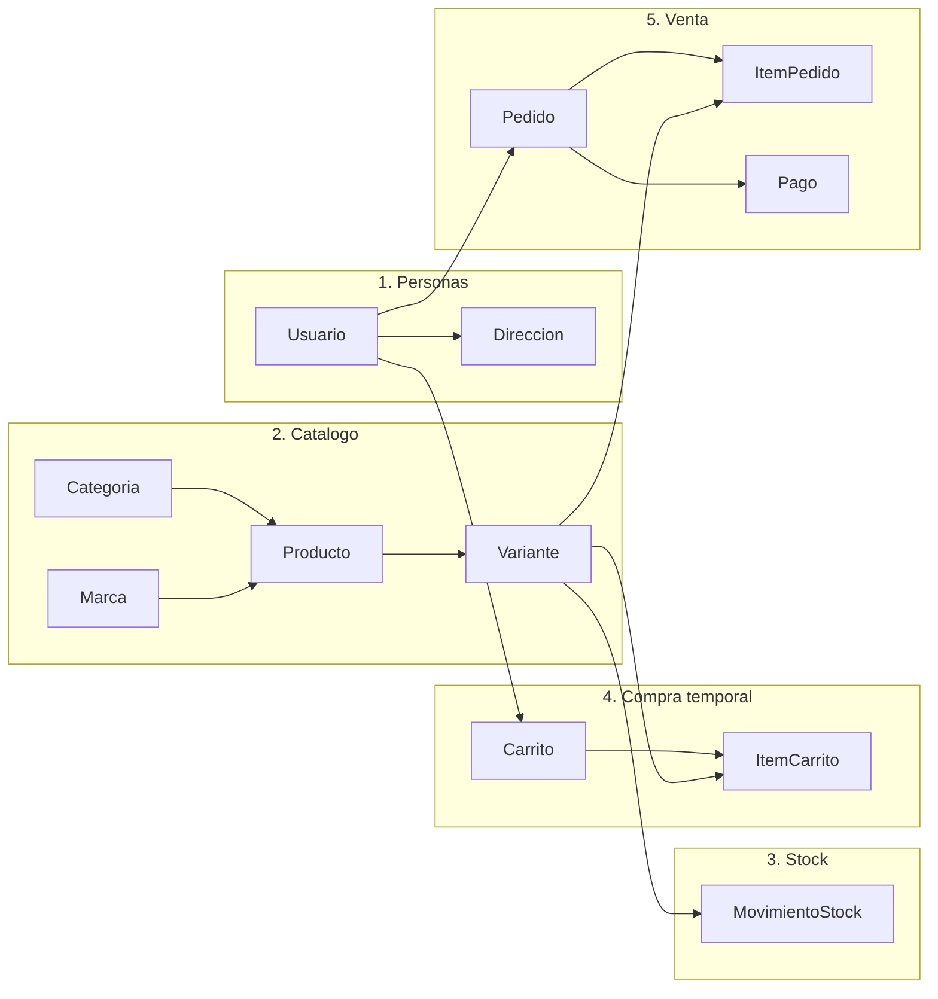
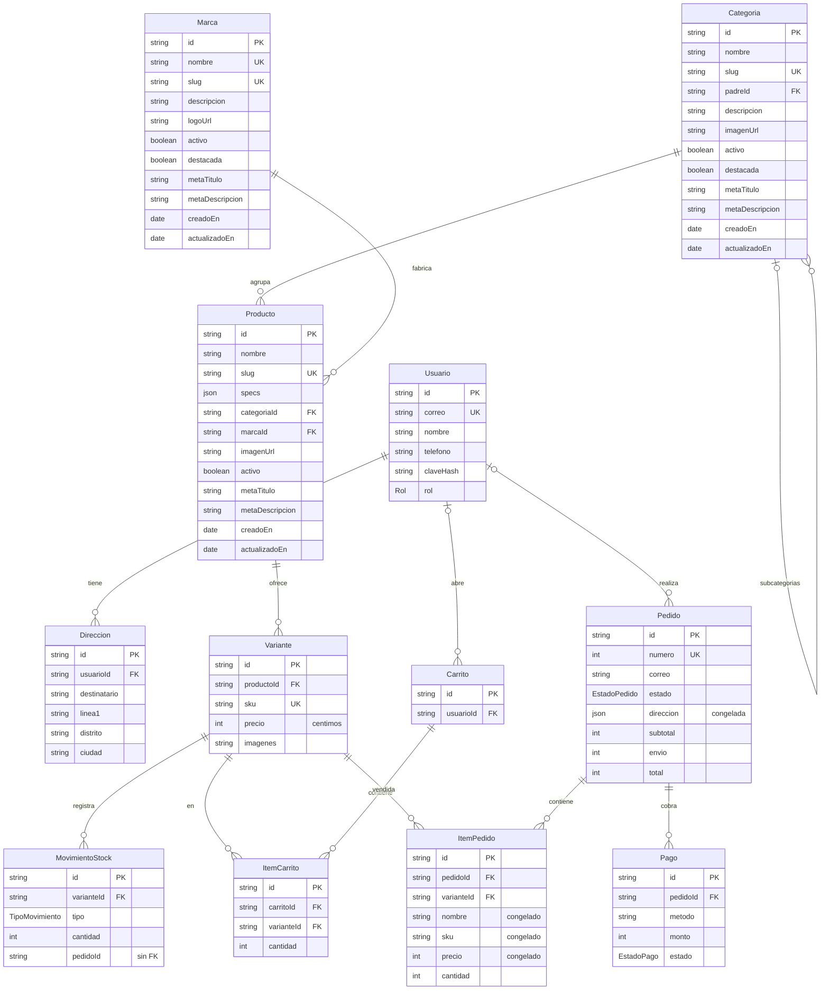

# Diagrama de la base de datos

Fuente de verdad: `prisma/schema.prisma`. Este archivo es solo una guia visual; si el esquema cambia, hay que actualizarlo a mano.

## Vista general (por bloques)

Las flechas van de la tabla "padre" a la tabla que depende de ella.

`Variante` es la pieza central: es lo que se vende, se guarda en carritos, entra en pedidos y mueve el stock.

## Detalle de columnas

## Valores de los enums

| Enum | Valores |
|---|---|
| `Rol` | `CLIENTE`, `ADMIN`, `ALMACEN` |
| `EstadoPedido` | `PENDIENTE`, `PAGADO`, `PREPARANDO`, `ENVIADO`, `ENTREGADO`, `CANCELADO` |
| `EstadoPago` | `PENDIENTE`, `PAGADO`, `FALLIDO`, `REEMBOLSADO` |
| `TipoMovimiento` | `ENTRADA`, `SALIDA`, `AJUSTE`, `RESERVA`, `DEVOLUCION` |

## Reglas que se ven en el esquema

- **Stock**: no hay columna de stock. Sale de sumar `MovimientoStock` por variante.
- **Precios**: siempre enteros en centimos.
- **Congelado en el pedido**: la direccion (`Pedido.direccion`) y el nombre, sku y precio (`ItemPedido`) se copian al comprar.
- **Compra como invitado**: `usuarioId` es opcional en `Carrito` y `Pedido`; el pedido guarda siempre el `correo`.
- **Pendiente de revisar**: `MovimientoStock.pedidoId` es un texto suelto, sin relacion real con `Pedido`.
- `_prisma_migrations` la crea Prisma para llevar el historial; no es parte del modelo.
